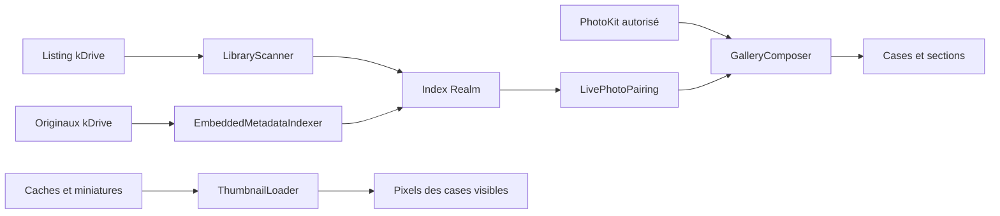
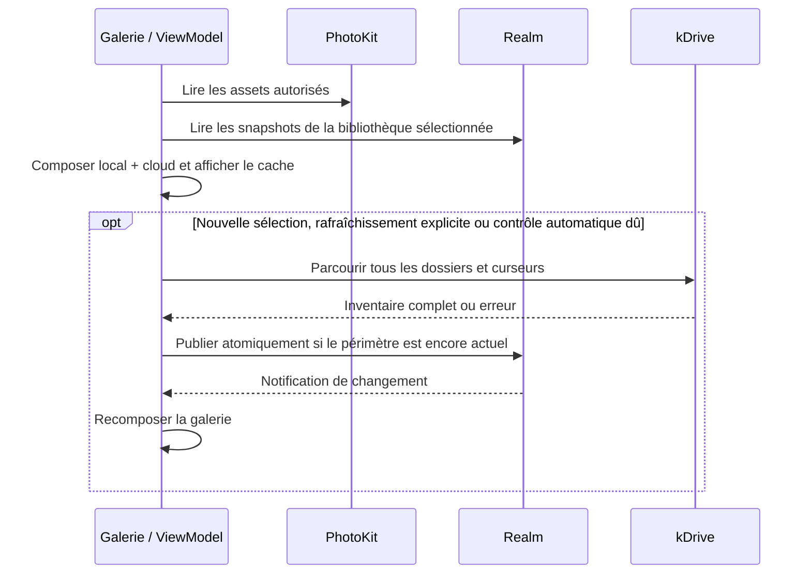
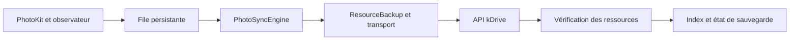

# Galerie, métadonnées et sauvegarde

## Organisation

| Couche | Responsabilité |
| --- | --- |
| `kPhotos` | Assemblage, cycle de vie, navigation racine |
| `kPhotosCore` | API, Realm, PhotoKit, indexation et sauvegarde ; aucun import SwiftUI/UIKit |
| `kPhotosCoreUI` | Composants réutilisables |
| `kPhotosFeatures` | Vues et ViewModels par fonctionnalité |
| `kPhotosResources` | Ressources et traductions |
| `kPhotosTests` | Logique métier et transports synthétiques |

## Sources et cheminement des données

| Source / composant | Contenu et rôle |
| --- | --- |
| PhotoKit (`PHAsset`) | Inventaire local autorisé, date de création, révision et ressources à sauvegarder |
| Listing kDrive | Identité, disponibilité et révision des originaux dans le dossier sélectionné |
| `LibraryScanner` | Parcours complet des dossiers/pages puis publication atomique de l'inventaire |
| `EmbeddedMetadataIndexer` | Lecture des métadonnées intégrées aux originaux, indépendante du défilement |
| Realm et snapshots | Index persistant et valeurs transmises aux ViewModels sans objet géré inter-thread |
| `GalleryComposer` | Fusion locale/cloud, déduplication, statuts et sections de la galerie |
| `LivePhotoPairing` | Association vérifiée image/vidéo, sans transformation des originaux |
| `ThumbnailLoader` | Chargement des pixels d'une case déjà présente dans la galerie |

L'inventaire décide qu'une case existe ; le chargeur d'image décide quels pixels elle affiche.
Une miniature manquante ne prouve pas qu'un original manque, et une miniature visible ne prouve pas une sauvegarde complète.
Le titre/date, l'identité et le statut viennent des données indexées, pas de l'image redimensionnée du serveur.

## Inventaire et dates

La galerie fusionne les assets PhotoKit autorisés et l'index Realm du dossier kDrive sélectionné.
`LibraryScanner` visite récursivement toutes les pages puis publie un inventaire atomique.
Une page manquante est une erreur ; un fichier absent est masqué, sans suppression de l'original.
Un résultat appartenant à une ancienne sélection ne remplace jamais la bibliothèque actuelle.
Les vérifications complètes automatiques sont espacées de 15 minutes ; le rafraîchissement explicite reste immédiat.

La référence temporelle est `PHAsset.creationDate` pour un asset local et la date intégrée à l'original pour le cloud.
Une date de fichier est un repli approximatif. Une date EXIF sans fuseau conserve sa valeur brute et son hypothèse d'heure locale.
Aucune coordonnée GPS n'est inventée. Les albums utilisent les catégories kDrive.

## Ouverture et actualisation

Les items liés à un identifiant PhotoKit sont fusionnés avec l'asset local correspondant ; les originaux cloud seuls restent consultables
sans permission Photos. Une modification locale invalide une ancienne preuve de sauvegarde pour cette révision.
Les changements de dossier, de disponibilité, de métadonnées et les notifications de file peuvent modifier la composition ou les statuts.
Le ViewModel doit vérifier le périmètre au retour d'un travail asynchrone, y compris pour afficher une erreur.

## Préparation des originaux

`EmbeddedMetadataIndexer` lit les métadonnées progressivement sur Wi-Fi, indépendamment du rendu de la galerie.
`MetadataIndexStore` gère la sélection, les tentatives et les diagnostics ; la pause est persistée par bibliothèque.
Une annulation laisse le média en attente. Les erreurs transitoires ont au maximum trois tentatives avec délai.
Une révision inchangée réutilise les résultats ; une nouvelle révision les invalide.

Les lectures d'images vont de 64 Kio à 32 Mio. Les vidéos passent par `RemoteMediaAsset` et des requêtes HTTPS Range
avec un budget cumulé de 32 Mio pour les métadonnées. Une réponse trop grande ignorant Range est rejetée avant son corps.
Une lecture partielle reste explicitement partielle, y compris si elle ne trouve pas de GPS.
La lecture vidéo utilise le même transport sans plafond cumulé et s'annule à la fermeture.
AVFoundation ne reçoit ni PAT ni URL signée directement.

La galerie n'ouvre aucun ZIP, JSON Google, CSV ou journal Takeout.
`PreparedMediaIndexSync` peut réutiliser le cache privé `.kphotos-index`, limité à 32 Mio,
après validation du producteur, schéma, drive, racine et révisions. Une nouvelle liste complète confirme la disponibilité.
`MediaIndexPublisher` produit ce cache sur l'iPhone et vérifie les octets écrits.
Seuls les caches dont la propriété est prouvée peuvent être versionnés ; jamais les originaux.
Ce cache peut contenir dates, coordonnées et identifiants de médias : ne pas le publier avec le dépôt.

## Miniatures et réseau

`ThumbnailRequestBroker` regroupe les demandes par drive/fichier/révision ; le dernier consommateur annule le transport.
La priorité est : média visible, anticipation/listing, puis préparation.
Le budget partagé est de 60 requêtes par fenêtre glissante ; 20 places sont réservées aux demandes prioritaires.
L'attente se déroule dans la tâche appelante avant la construction de la requête, jamais dans `AuthInterceptor`.

Les miniatures disposent de 96 Mio de RAM et 512 Mio de disque ; les previews de 256 Mio de disque.
Les écritures laissent 128 Mio libres. Décodage, lecture disque et éviction ne bloquent pas le rendu d'une case.
Les caches sont jetables et ne contiennent pas les originaux de sauvegarde.

### Sources de miniatures et replis

Le parcours privilégie RAM, disque, puis un paquet de miniatures kPhotos validé lorsqu'il est référencé.
Une preview déjà en cache peut également être réutilisée avant de solliciter les dérivés serveur.
Ensuite viennent la miniature kDrive, la preview, puis l'original uniquement pour une image admissible de 20 Mo au maximum.
Une erreur d'authentification, de quota ou une annulation ne déclenche pas une cascade de téléchargements de repli.

`ThumbnailPackStore` partage les téléchargements de paquets, vérifie leur SHA-256 et limite chaque paquet à 16 Mio.
La lecture interne doit correspondre au fichier et à sa révision. Un paquet absent/corrompu ne bloque pas les miniatures ordinaires.
Ces paquets sont des dérivés propres à kPhotos, pas un lecteur de catalogues arbitraires.

Une case brièvement traversée attend avant de consommer le réseau ; les consommateurs hors écran libèrent leurs demandes.
Les cellules libèrent aussi leur image décodée tout en laissant le cache partagé réutilisable.
Un premier passage sans cache dépend du réseau, du quota et des dérivés serveur disponibles ; aucune équivalence de performance
avec une autre photothèque n'est garantie.

## Live Photos et visualisation

`LivePhotoPairing` associe exactement une image et une courte vidéo portant le même identifiant Apple intégré,
dans le même drive/dossier. Un nom similaire ne suffit pas. Les deux originaux restent intacts sur kDrive.
La galerie masque la vidéo associée ; consultation, albums, suppression et import PhotoKit transportent les deux ressources.
ImageIO détermine l'extension temporaire selon les octets réels, sans renommer le fichier cloud.

Les identifiants doivent être extraits des deux originaux avant de pouvoir établir la paire.
Une ancienne entrée sans ces métadonnées peut rester une case vidéo jusqu'à son passage dans la préparation Wi-Fi.
Le nom peut aider à investiguer un candidat, mais ne constitue jamais une preuve d'association.
Les annotations Google et les archives restent conservées sans être utilisées comme source de liaison.

Le visualiseur sépare pagination, chargement, zoom, informations et actions.
Le zoom natif iOS 18+ utilise la même identité que la miniature source ; iOS 16–17 conserve le geste de repli.
Les gestes horizontaux respectent le zoom et la fermeture verticale interactive.

## Sauvegarde et persistance

`ResourceBackup` exporte les ressources PhotoKit et un manifeste JSON, puis vérifie les téléchargements par SHA-256.
Une taille identique ne prouve pas l'intégrité. Tous les éléments requis doivent réussir avant `backupComplete`.
Les uploads incluent la date de capture, utilisent `conflict=error` et passent en mode chunked au-delà de 50 Mo.
Les jetons de reprise restent dans le Keychain. Un verrou partagé évite deux vidages concurrents de la file.
Un échec marque l'élément en erreur sans bloquer les suivants.

Le statut global exige des originaux disponibles, vérifiés et conformes à la révision locale dans le drive/dossier exact.
Les accès PhotoKit limités et filtres ne prouvent que la complétude de la sélection autorisée.
Les changements PhotoKit et retours au premier plan déclenchent une réévaluation.
iOS décide du temps disponible en arrière-plan ; aucun délai de fin n'est garanti.

Les écritures Realm passent par `RealmAccessor` en arrière-plan. Les objets gérés ne traversent ni retour de fonction
ni suspension async : les interfaces exposent des snapshots `Sendable`.
La migration d'une base non chiffrée produit une copie chiffrée vérifiée et conserve l'original protégé dans `DiagnosticBackups`.
Une erreur de clé inconnue ne doit jamais provoquer une reconstruction automatique. Les fichiers auxiliaires Realm peuvent être des pipes.

## Répartition des responsabilités du visualiseur

| Fichier / type | Responsabilité |
| --- | --- |
| `FullscreenMediaView` | Assemblage du visualiseur et sélection courante |
| `MediaPageView` | Chargement et rendu d'une page média |
| `ZoomableMediaView` | Conteneur de zoom et interaction image |
| `MediaInfoView` / `MediaInfoViewModel` | Informations et inspection de l'original sélectionné |
| `ViewerActionsViewModel` | Actions sur le média et ses ressources associées |
| `ViewerPagingGesture` / `MediaViewerTransition` | Arbitrage des gestes et identité de transition |

Le visualiseur ne doit pas absorber les règles de sauvegarde, les requêtes Realm ou le calcul de provenance.
Une inspection ponctuelle peut lire l'original sélectionné ; elle ne doit pas lancer une analyse de toute la bibliothèque.

## Cas à couvrir avant de changer ce flux

- Une page manquante, une interruption ou une erreur de curseur conserve le précédent inventaire complet.
- Un changement de sélection pendant une requête ne laisse apparaître ni résultat ni erreur de l'ancienne bibliothèque.
- Une nouvelle révision invalide les métadonnées, miniatures et preuves de sauvegarde qui en dépendent.
- Une lecture partielle sans GPS reste différente d'une lecture complète confirmant l'absence de GPS.
- Deux noms semblables ne forment pas une Live Photo ; une association ambiguë reste séparée.
- L'annulation du dernier consommateur coupe le transport partagé ; celle d'un seul consommateur ne pénalise pas les autres.
- Une sélection Photos limitée ou filtrée ne permet pas d'annoncer la sauvegarde complète de toute la photothèque.
- Une erreur de clé Realm ou de migration conserve l'original au lieu de recréer une base vide.

Les tests ciblent ces invariants avec des données synthétiques et Realm en mémoire.
La reprise réelle en arrière-plan, les ressources PhotoKit accessibles et les contraintes disque exigent aussi une validation sur appareil.
Les preuves ponctuelles d'une session de développement restent dans les notes locales, pas dans ce document de référence.

## Arrière-plan et responsabilités de synchronisation

`BackgroundSyncScheduler` orchestre les créneaux système de sauvegarde ; `LibraryPreparationScheduler` orchestre
la préparation des métadonnées. Ces deux tâches ont des responsabilités et des progressions distinctes.
L'expiration du créneau iOS annule la tâche structurée et doit laisser un état reprenable.
Le système décide quand lancer les requêtes de rafraîchissement/traitement : une date de lancement souhaitée
ou un téléphone en charge ne garantit ni fréquence ni durée disponible.
L'onboarding et les statuts doivent expliquer cette contrainte, sans annoncer une synchronisation permanente.
